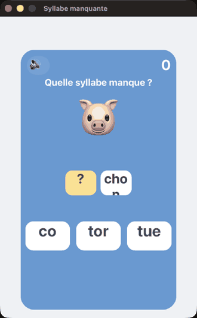

# MissingSyllable

**"Syllabe manquante" — a syllable game for kids.** A picture and its word are shown with one
syllable blanked (che · **?**); tap the missing syllable among the choices. Built on
[Hero](https://github.com/mesopelagique/Hero) (`cs.hero`).

## Play

Open the project — `On Startup` launches it. Read the word with the gap, tap the syllable that
fills it. A correct call bumps the **score**; a wrong one reveals the answer, shakes and beeps.

## `cs.MissingSyllable`

| Function | Action |
|:-|:-|
| `.newQuestion()` | Pick a word, blank one syllable, offer syllable choices. |
| `.choose($i)` | Judge the tapped syllable, reveal, score, advance. |
